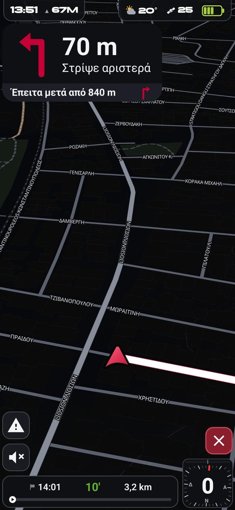
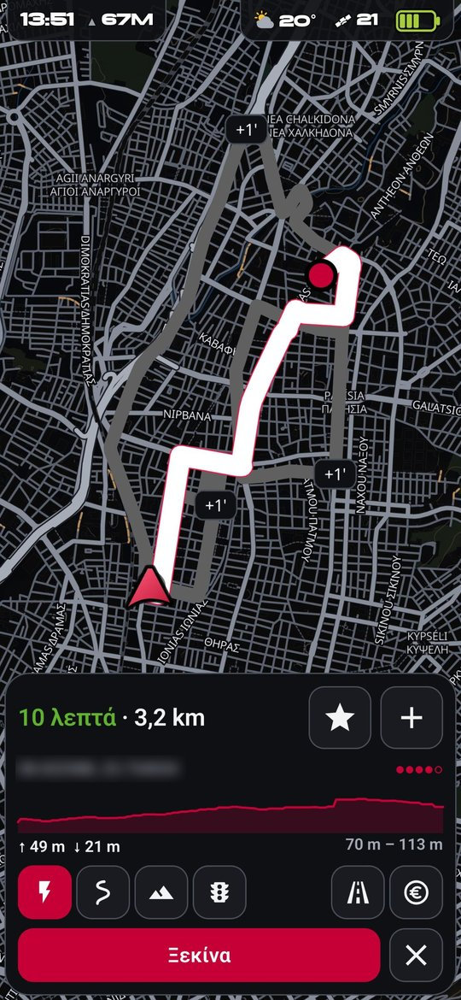
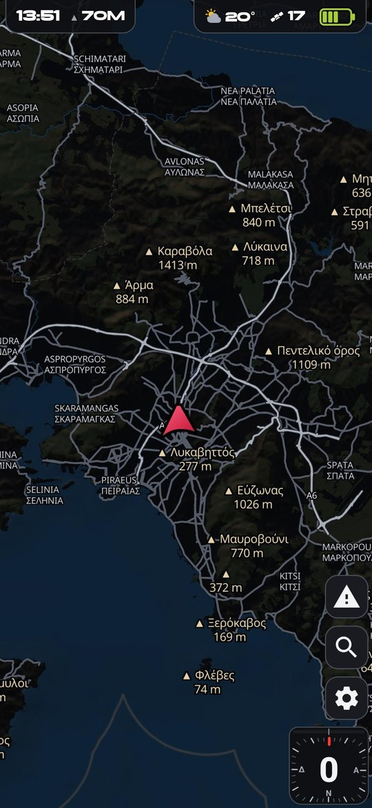
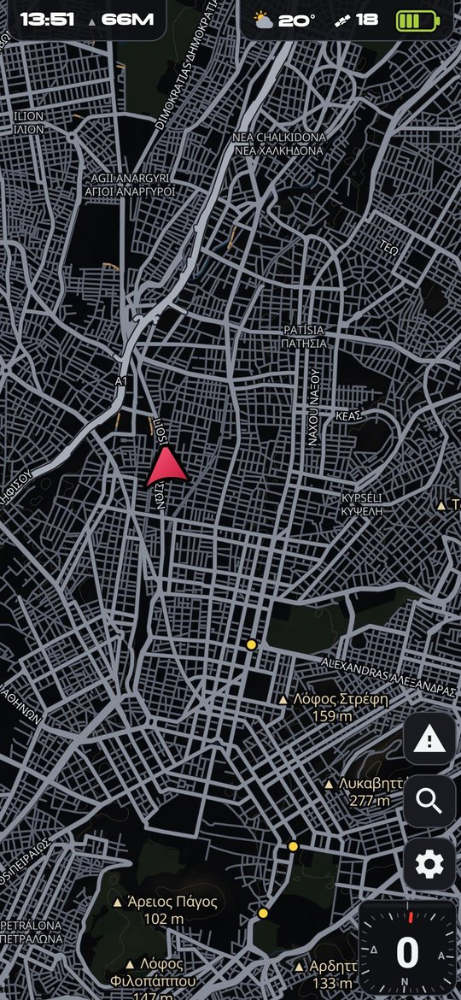
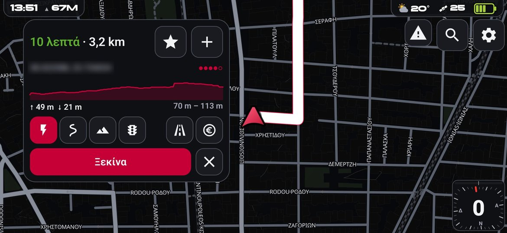
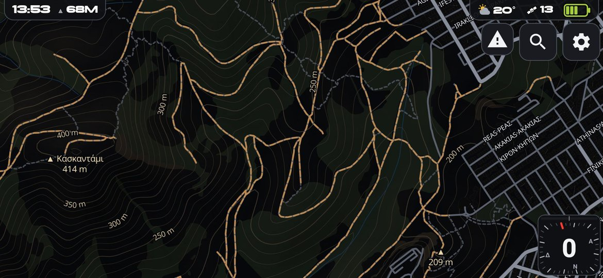
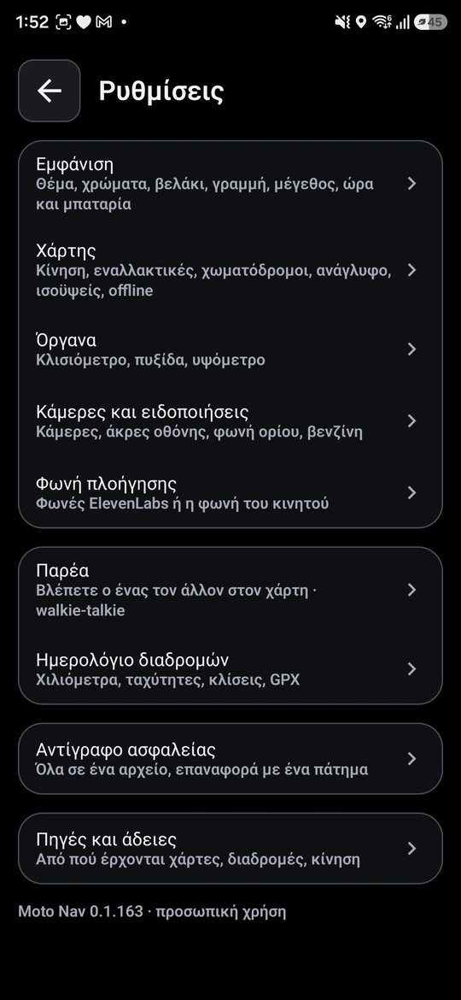
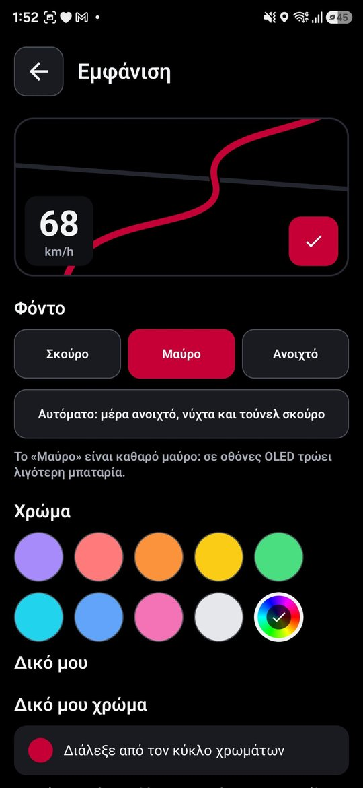
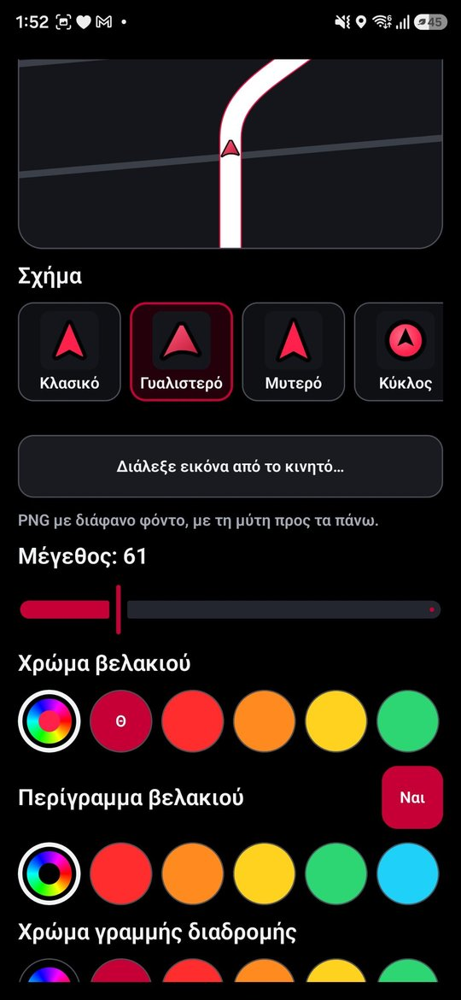

# Streetwolf

[🇬🇷 Ελληνικά](README.md) · 🇬🇧 English · (formerly Moto Nav)

Free GPS navigation app for motorcycles, for Android.
Curvy or dirt routes, voice guidance in English or Greek, cameras, fuel, instruments, group riding with walkie-talkie.
Maps from OpenStreetMap. Big buttons for gloves. The whole app is in English and Greek.

  
  
  
  

Navigation · Route with elevation and alternatives · Relief and peaks · City

  
  

Landscape, for a handlebar mount · Dirt roads and contours for off-road

## Installation

### What you need
- An **Android 8 or newer** phone with GPS.
- **BRouter** (free, [Play Store](https://play.google.com/store/apps/details?id=btools.routingapp) or [F-Droid](https://f-droid.org/packages/btools.routingapp/)): calculates routes on the phone, without internet.

### Steps
1. **BRouter**: install → open it → «Download Manager» → pick the squares for your area → «Start Download». Only once.
2. **Streetwolf**: on the phone, open this repo's **Releases** (on the right of the page, or add `/releases/latest` to the address) and tap `moto-nav.apk`.
3. The first time, Android asks for the «Install unknown apps» permission for the browser. Allow it.
4. Open Streetwolf and allow **location** (and notifications, for navigation with the screen off).
5. **Language**: Settings → «Γλώσσα · Language» → **Phone** (English unless the phone is in Greek), **Ελληνικά** or **English**.
6. Later versions install over the old one, without uninstalling. The app tells you itself («New version → Install»), or Settings → «Check for a new version», which downloads it and opens the installer.

### Optional: free keys (Settings)
They stay only on your phone and go nowhere else.
- **TomTom** ([my.tomtom.com/keys](https://my.tomtom.com/keys)): live traffic, arrival time with traffic, lanes, house numbers, more fuel stations.
- **MapTiler** ([cloud.maptiler.com](https://cloud.maptiler.com)): contour lines.
- **ElevenLabs**: more natural navigation voices.

Everything else works without keys.

### First ride
1. Tap search, type or say the destination → **Go**.
2. Pick a type: **Fast**, **Curvy**, **Dirt** or **Traffic**. Tap a grey line to pick an alternative.
3. **Start**. You can lock the screen, the voice keeps going.
4. Finish with **✕**. The ride is saved in the Ride log.

### iPhone (and computer): the web version
Open **https://mind-osc.github.io/motonav-/** in **Safari** → **Share** ⇪ → **«Add to Home Screen»**. It opens like an app, with the same layout and menus as the Android one.
It also opens on Android (Chrome) or a computer, but on Android the real app (APK) is always better.

#### What works and what doesn't

| | Android (APK) | iPhone / web |
|---|:---:|:---:|
| Search, categories (fuel, coffee, food, sleep, garages, water) | ✅ | ✅ |
| Fast / Curvy / Dirt routes | ✅ offline | ✅ with internet |
| Traffic (TomTom, with your own key) | ✅ | ✅ |
| Alternatives, avoids, avoid areas, round trip, stops | ✅ | ✅ |
| Voice navigation (English / Greek, ElevenLabs) | ✅ | ✅ |
| Navigation with the screen off or another app in front | ✅ | ❌ the screen must stay on |
| Cameras, speed limit, fuel and weather on the route | ✅ | ✅ |
| Road closed / new route, skip stop, simulation | ✅ | ✅ |
| Places for riders, favourites in lists, saved routes | ✅ | ✅ |
| GPX / KML / GeoJSON (open and export) | ✅ | ✅ (not ITN) |
| Ride log with recording | ✅ | ✅ while the screen is on |
| Lean meter, compass | ✅ | ✅ (iPhone asks for permission) |
| Themes, colours, backup | ✅ | ✅ (separate from Android) |
| Offline maps | ✅ | ❌ |
| Group (positions on the map, walkie-talkie), hazard reports | ✅ | ❌ |
| Handlebar controller (Bluetooth) | ✅ | ❌ |
| Android Auto / CarPlay, small window (PiP) | ✅ Android Auto | ❌ |
| Automatic updates | ✅ from inside the app | ✅ by itself, every time it opens |

Favourites, routes and the ride log of the web version stay in the browser and don't move to Android (or back). Keep a backup, because if you clear Safari's data they are lost.

### New phone or reinstall
Settings → **Backup** → «Save backup». On the new phone: «Restore from backup». Keys, settings, favourites, voice, group, cameras, reports and ride log come back. Offline maps are downloaded again.

## What it does

### Route
- **4 route types**: Fast, **Curvy** (away from motorways, picks the twistiest within +60% time), **Dirt** (our own profile for dirt roads, without closed/private roads and footpaths), **Traffic** (TomTom, with live traffic).
- **Avoid** motorways and tolls with a switch, and (Settings → Map) **ferries, main roads, very narrow roads, dirt roads**.
- **Up to 4 alternatives** on the map with «+3′ / −2′», only sensible ones (not much slower or longer). Tap one and it becomes the main route. On short routes (< 5 km) with the «⇄ Alternatives» button.
- **Long-press on the map** = route there (it takes the street/village name).
- **Stops** in between, numbered on the map, that disappear once you pass them.
- **Recent routes**: the last 10, again with one tap (same destination, stops, type).
- The **route card folds away** (handle on top), so you see more map.
- **Round trip**: pick 1–4 hours, it makes a curvy loop back to the start; different every time.
- **Extra curvy** (Settings → Map): the «Curvy» type looks for even twistier roads.
- **Avoid areas**: ⊘ on a spot → routes don't pass there (300 m / 1 km / 3 km). Red circles on the map, tap = delete. (Not in the «Traffic» type.)
- **Elevation chart** (climb/descent, low–high) and **weather along the route** at the time you'll pass.
- **GPX, KML, GeoJSON, ITN**: open a file and «Follow» the track exactly (from wherever you are, like saved routes), and **«⇅ Reverse»**; export and share.
- **Simulation**: long-press «Start» and the route «runs» with the instructions (1×/2×/4×), to see it before you leave.
- **Direction arrows** on the line.

### Navigation
- **Voice instructions in English or Greek**, with street names (in Latin letters in English). Phone voice or ElevenLabs. Plays through the helmet intercom (Bluetooth).
- **Turn sign** with distance and «Then…» for the one after, coloured by road type (green motorway, blue national/main, orange dirt, burgundy last turn), on every route type.
- **Lanes, exits, signposts** (with a TomTom route).
- **Time bar**: arrival, time, kilometres, progress of the whole trip (also after a new route). Green without traffic, orange/red with delay. Traffic refreshes every 5 minutes.
- **Stops while navigating**: «📍 Stop 1 in 12 km»; tap → «Go here», «Skip next», «Straight to the end».
- **Road closed ahead** (⚠ button): takes you another way. **New route from here** with one tap.
- **New route by itself** if you leave it: 2″ if you go elsewhere, 4″ if the GPS just jumps beside it (city). In «Traffic» it keeps your road unless another is ≥ 3′ faster.
- The line **erases behind you**, the arrow **sticks to the road** and moves smoothly at speed.
- **Auto zoom** with speed and near turns; re-centres by itself after 7″.
- **Whole route with one tap**: tap the compass/speed while it's following you → overview of the remaining route.
- **Handlebar controller** (Carpe Iter, WunderLINQ, Parrot, Bluetooth remote): zoom, centre, voice, report, search; choose which button does what in Settings.
- **In the background and with the screen off** (notification with the next instruction) and in a **small window** (picture-in-picture).
- **Android Auto**.

### Alerts
- **Speed limit** next to the speed, red when you exceed it, voice «Speed limit 50».
- **Cameras**: from OpenStreetMap + Attica cameras (red-light, AI) + your own marks. Yellow bar and voice 300 m before. Can be turned off in Settings.
- **Hazard reports** (oil, pothole, animal, works, road closed etc.) in 2 taps; they expire by themselves; alert 500 m before.
- **Weather**: «Caution, rain in 8 kilometres».
- **Glow on the screen edges**: red over the limit, orange hazard, yellow camera.

### Fuel
- **Fuel stations on the route**: «⛽ in X km», list, «Stop» on the move; offline too.
- Warning for a long gap without fuel (≥ 150 km).

### Instruments
- **Speed** from GPS, **compass**, **elevation**, **road grade** (%).
- **Lean meter**: how far the bike leans in the turn (speed × gyroscope × accelerometer), accurate at big lean angles too, however the phone is mounted. Left/right maximums; tap = reset.
- **Acceleration (g) and 0–100**: tall strip on the right edge, green downwards on throttle, red upwards on braking, with maximums; 0–100 timer that starts by itself when you pull away from a stop.
- Choose which ones show.

### Group (2–5 friends)
- **See each other on the map**: arrow in each rider's colour, name, speed, destination and route.
- **Walkie-talkie**: talk and they hear, by voice (VOX) or button.
- Join with a **code, QR or link**.
- **End-to-end encryption** (AES-256-GCM): not even the server sees positions and voice messages. Positions are deleted after 30′, voice after 2′.

### Map
- **Dark / Black (AMOLED) / Light / Auto** (from the sun and the light sensor). 9 colours + your own.
- **Mountain relief**, peaks with elevation, contours, **dirt roads** dashed.
- **Live traffic** as thin lines, only where there's delay.
- **Places for riders** from OpenStreetMap, with photos.
- **Offline maps**: Greece (main roads), the area you're looking at in full detail, and 12 neighbouring countries for travel. They update themselves every month on Wi‑Fi.
- **Bookmarks** as coloured dots; tap = route there.
- ⚑ **Mistake on the map?** Note to OpenStreetMap from the destination card.

### Search
- Addresses and places by **voice or text**, smart in Greek too (no accents needed, abbreviations like «Λ.», declensions).
- **Categories near you**: fuel, food, coffee, garage, sleep, viewpoint, water, washes; **offline too**.
- **Offline**: towns, villages, settlements, islands, peaks, passes and **streets** of all of Greece (without house number; it takes you to the street, nearest part first).
- **Opening hours, phone, website** of the place on the card (from OpenStreetMap).
- **Home, Work, bookmarks in coloured lists** (e.g. «Pelion rides»), recent. Import from GPX/KML, share a list as GPX.
- The keyboard locks above 10 km/h.

### Apps and music
- **«Apps» button** (▦) on the map: add any apps you like (e.g. Spotify, WhatsApp) and open them from there. Long-press one to remove it.
- **Music pill**: music apps (Spotify, YouTube Music, Deezer, podcasts…) don't take you off the map; a thin pill appears with cover, title and ⏮ ▶ ⏭. In landscape it sits under the buttons top right.
- With ▶ (or a tap on the map) it slides up by itself and leaves a small handle at the very top; tap near it and it comes back down.
- Needs «Notification access» for Streetwolf once (to control the music). Works with any music app, no account needed.

### Ride log and backup
- Every ride is recorded: kilometres, time, average/top speed, max lean left/right, elevation, climb. Show on the map, share GPX.
- **Recording without navigation too**, with **pause** (e.g. at the café).
- **Saved routes**: at the end of every ride «Save?» with a name (the whole track from the start). Ride them again from search → «Saved routes», on exactly the same roads, **from wherever you are**: it takes you to its nearest point (ahead) and brings you back onto it if you leave. Rename/delete: Settings → Bookmarks and routes.
- **Backup** of everything in one file, restore with one tap.

## Buy me a coffee ☕

The app is and will stay free, with no ads and no subscriptions. If you found it useful and want to support what comes next:
**[Buy me a coffee via PayPal](https://paypal.me/STAVROSMALAGARDIS)** (also in the app: Settings → «Buy me a coffee»).

## Not there yet

- House numbers offline (offline it takes you to the street, not the number).
- Refuel planning with the tank's range.

## Data sources

OpenStreetMap (map, cameras, fuel, places) · OpenFreeMap (tiles) · BRouter (routes) · Photon / Nominatim (search) · Open-Meteo (weather) · AWS Terrain Tiles (relief) · TomTom, ElevenLabs, MapTiler (with your own key) · Firebase (group) · [4GPS](https://pois.4gps.gr) (points of interest when you import them, with permission from 4GPS).

## Licence

MIT. See `LICENSE`. Barlow Condensed font: SIL OFL 1.1 (`licenses/`).

## Customisation

  
  
  

Settings · Dark / Black / Light / Auto, 9 colours or your own · Arrow shape, size and colour, or your own image

## For developers

The build (GitHub Actions) needs the Secrets `KEYSTORE_BASE64` (keystore in base64) and `KEYSTORE_PASSWORD`, and optionally `GOOGLE_SERVICES_JSON` (for Group, from your own Firebase project). Without a key only the tests and the build run, with no Release.

**Translations**: every text goes through `tr("…")` / `trf("… {0} …", x)` with the Greek text as the key; the English is in `app/src/main/java/app/motonav/i18n/En.kt`. A test fails the build if a text has no English translation.

## Technical

Kotlin + Jetpack Compose, MapLibre Native 11.8, Android Auto (Car App Library), minSdk 26.
Build: Gradle 8.11.1, AGP 8.7.3, JDK 17. Tests (JUnit) run before every build.
Design tokens and themes in the `replica/design/` folder.
