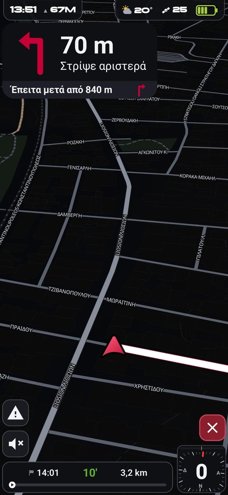
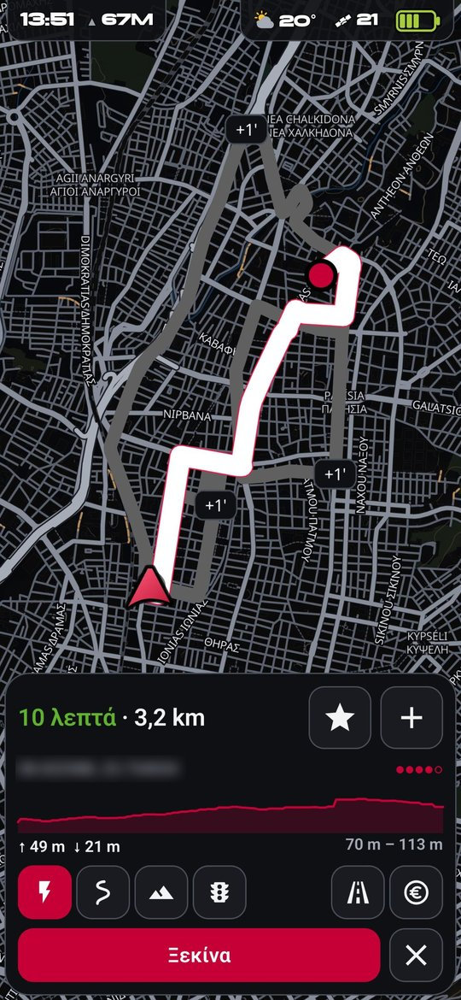
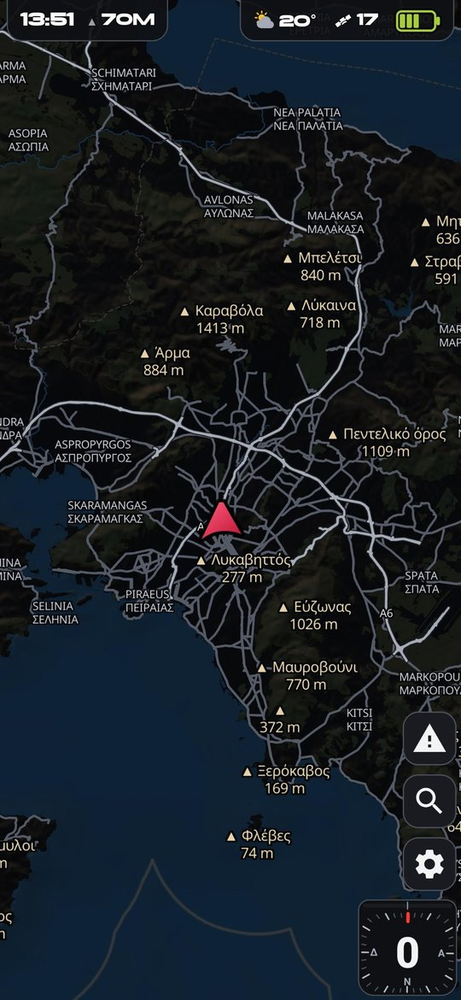
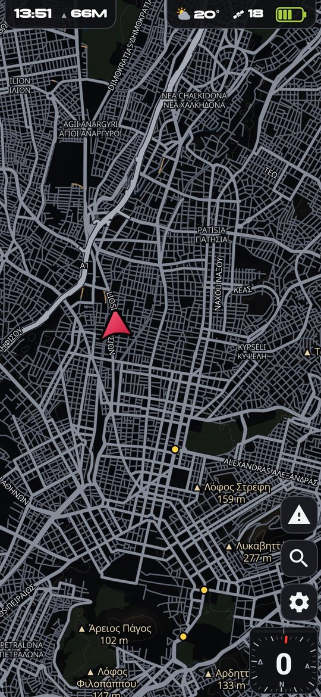
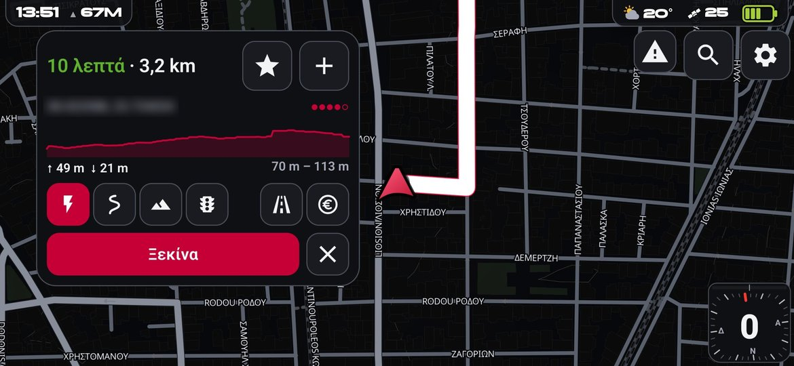
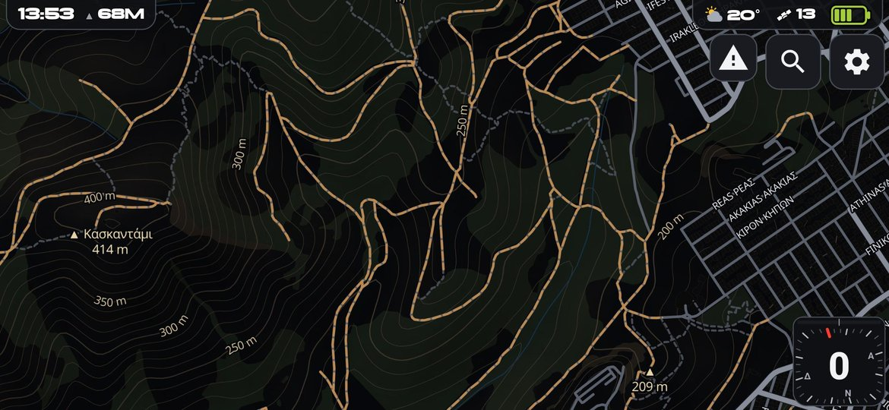
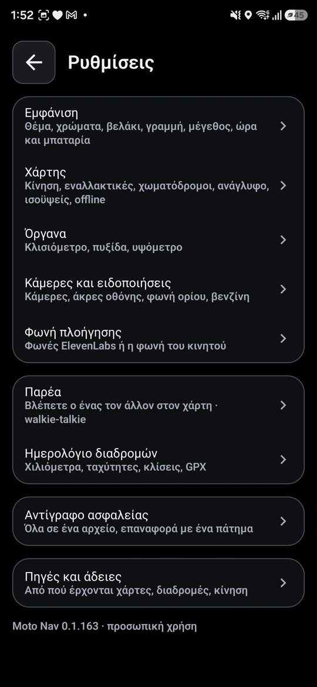
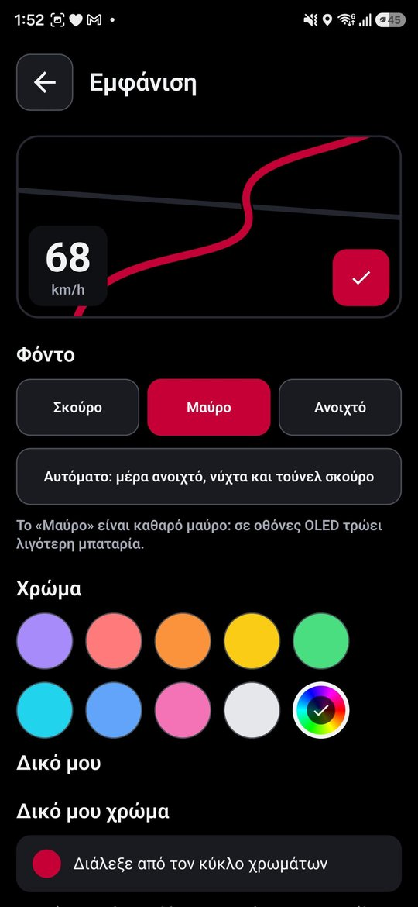
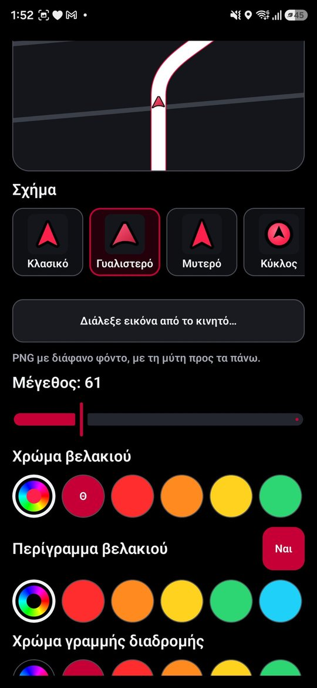

# Moto Nav

Δωρεάν εφαρμογή πλοήγησης GPS για μηχανή, για Android.
Διαδρομές με στροφές ή χώμα, φωνή στα ελληνικά, κάμερες, βενζίνη, όργανα, παρέα με walkie-talkie.
Χάρτες από OpenStreetMap. Μεγάλα κουμπιά για γάντια.

  
  
  
  

Πλοήγηση · Διαδρομή με υψόμετρο και εναλλακτικές · Ανάγλυφο και κορυφές · Πόλη

  
  

Οριζόντια, για βάση στο τιμόνι · Χωματόδρομοι και ισοϋψείς για off-road

## Εγκατάσταση

### Τι χρειάζεσαι
- Κινητό **Android 8 ή νεότερο** με GPS.
- **BRouter** (δωρεάν, [Play Store](https://play.google.com/store/apps/details?id=btools.routingapp) ή [F-Droid](https://f-droid.org/packages/btools.routingapp/)): υπολογίζει τις διαδρομές μέσα στο κινητό, χωρίς internet.

### Βήματα
1. **BRouter**: εγκατάσταση → άνοιξέ το → «Download Manager» → διάλεξε τα τετράγωνα της Ελλάδας → «Start Download». Μία φορά μόνο.
2. **Moto Nav**: από το κινητό, άνοιξε τα **Releases** αυτού του repo (δεξιά στη σελίδα, ή πρόσθεσε `/releases/latest` στη διεύθυνση) και πάτα το `moto-nav.apk`.
3. Την πρώτη φορά το Android ζητάει άδεια «Εγκατάσταση άγνωστων εφαρμογών» για τον browser. Δώσ' την.
4. Άνοιξε το Moto Nav και δώσε άδεια **τοποθεσίας** (και ειδοποιήσεων, για πλοήγηση με σβηστή οθόνη).
5. Οι επόμενες εκδόσεις μπαίνουν από πάνω, χωρίς απεγκατάσταση. Η εφαρμογή σε ειδοποιεί μόνη της («Νέα έκδοση → Εγκατάσταση»), ή Ρυθμίσεις → «Έλεγχος για νέα έκδοση».

### Προαιρετικά: δωρεάν κλειδιά (Ρυθμίσεις)
Μένουν μόνο στο κινητό σου, δεν πάνε πουθενά αλλού.
- **TomTom** ([my.tomtom.com/keys](https://my.tomtom.com/keys)): live κίνηση, χρόνος άφιξης με κίνηση, λωρίδες, αριθμοί σπιτιών, περισσότερα βενζινάδικα.
- **MapTiler** ([cloud.maptiler.com](https://cloud.maptiler.com)): ισοϋψείς καμπύλες.
- **ElevenLabs**: πιο φυσικές φωνές πλοήγησης.

Χωρίς κλειδιά δουλεύουν όλα τα υπόλοιπα.

### Πρώτη βόλτα
1. Πάτα την αναζήτηση, γράψε ή πες τον προορισμό → **Πάμε**.
2. Διάλεξε τύπο: **Γρήγορη**, **Στροφές**, **Χώμα** ή **Κίνηση**. Πάτα μια γκρι γραμμή για να διαλέξεις εναλλακτική.
3. **Ξεκίνα**. Μπορείς να κλειδώσεις την οθόνη, η φωνή συνεχίζει.
4. Τέλος με το **✕**. Η διαδρομή γράφεται στο Ημερολόγιο.

### iPhone (και υπολογιστής): η web έκδοση
Άνοιξε στο **Safari** το **https://mind-osc.github.io/motonav-/** → **Κοινοποίηση** ⇪ → **«Προσθήκη στην οθόνη Αφετηρίας»**. Ανοίγει σαν εφαρμογή.
- Έχει: αναζήτηση, παρατεταμένο πάτημα στον χάρτη για προορισμό/στάση, διαδρομές **Γρήγορη / Στροφές / Χώμα**, χωρίς αυτοκινητόδρομους/διόδια, υψομετρικό, **πλοήγηση με φωνή στα ελληνικά**, αποθηκευμένες διαδρομές, κοινοποίηση με σύνδεσμο, άνοιγμα και εξαγωγή **GPX**.
- Διαφορές από το Android: οι διαδρομές θέλουν **internet** (υπολογίζονται online από το [BRouter](https://brouter.de)), και η πλοήγηση δουλεύει **όσο η οθόνη είναι ανοιχτή και η εφαρμογή μπροστά** (περιορισμός του iPhone για web εφαρμογές). Δεν έχει offline χάρτες, κάμερες, κίνηση, παρέα και CarPlay.

### Αλλαγή κινητού ή επανεγκατάσταση
Ρυθμίσεις → **Αντίγραφο ασφαλείας** → «Αποθήκευση αντιγράφου». Στο νέο κινητό: «Επαναφορά από αντίγραφο». Επανέρχονται κλειδιά, ρυθμίσεις, αγαπημένα, φωνή, παρέα, κάμερες, αναφορές και ημερολόγιο. Οι offline χάρτες ξανακατεβαίνουν.

## Τι κάνει

### Διαδρομή
- **4 τύποι διαδρομής**: Γρήγορη, **Στροφές** (μακριά από αυτοκινητόδρομους, διαλέγει την πιο στριφτή μέσα σε +60% χρόνο), **Χώμα** (δικό μας προφίλ για χωματόδρομους, χωρίς κλειστούς/ιδιωτικούς δρόμους και μονοπάτια), **Κίνηση** (TomTom, με live κίνηση).
- **Αποφυγή** αυτοκινητοδρόμων και διοδίων με διακόπτη, και (Ρυθμίσεις → Χάρτης) **πλοίων, κύριων δρόμων, πολύ στενών δρόμων, χωματόδρομων**.
- **Έως 4 εναλλακτικές** στον χάρτη με «+3′ / −2′», μόνο λογικές (όχι πολύ πιο αργές ή μακριές). Πάτημα και γίνεται κύρια. Σε μικρές διαδρομές (< 5 km) με το κουμπί «⇄ Εναλλακτικές».
- **Παρατεταμένο πάτημα στον χάρτη** = διαδρομή εκεί (παίρνει όνομα δρόμου/χωριού).
- **Στάσεις** ενδιάμεσα, με αριθμό στον χάρτη, που φεύγουν μόλις τις περάσεις.
- **Πρόσφατες διαδρομές**: οι 10 τελευταίες, ξανά με ένα πάτημα (ίδιος προορισμός, στάσεις, τύπος).
- Η **κάρτα διαδρομής μαζεύει** (λαβή πάνω), για να βλέπεις περισσότερο χάρτη.
- **Κυκλική βόλτα**: διαλέγεις 1–4 ώρες, βγάζει κύκλο με πολλές στροφές που γυρίζει πίσω· κάθε φορά διαφορετικό.
- **Πολλές στροφές** (Ρυθμίσεις → Χάρτης): ο τύπος «Στροφές» ψάχνει ακόμα πιο στριφτούς δρόμους.
- **Περιοχές αποφυγής**: ⊘ σε ένα σημείο → οι διαδρομές δεν περνάνε από εκεί (300 m / 1 km / 3 km). Κόκκινοι κύκλοι στον χάρτη, πάτημα = σβήσιμο. (Όχι στον τύπο «Κίνηση».)
- **Γράφημα υψομέτρου** (ανάβαση/κατάβαση, χαμηλό–ψηλό) και **καιρός κατά μήκος της διαδρομής** με την ώρα που θα περάσεις.
- **GPX, KML, GeoJSON, ITN**: άνοιγμα αρχείου και «Ακολούθησε» το ίχνος ακριβώς (από όπου κι αν είσαι, όπως οι αποθηκευμένες), και **«⇅ Ανάποδα»**· εξαγωγή και κοινοποίηση.
- **Προσομοίωση**: κράτα πατημένο το «Ξεκίνα» και η διαδρομή «τρέχει» με τις οδηγίες (1×/2×/4×), για να τη δεις πριν φύγεις.
- **Βελάκια κατεύθυνσης** πάνω στη γραμμή.

### Πλοήγηση
- **Φωνητικές οδηγίες στα ελληνικά**, με ονόματα δρόμων. Φωνή του κινητού ή ElevenLabs. Παίζει από ενδοεπικοινωνία κράνους (Bluetooth).
- **Ταμπέλα στροφής** με απόσταση και «Έπειτα…» για τη μεθεπόμενη, χρώμα ανάλογα με τον δρόμο (πράσινο αυτοκινητόδρομος, μπλε εθνική/κύρια, πορτοκαλί χώμα, μπορντό τελευταία στροφή), σε όλους τους τύπους διαδρομής.
- **Λωρίδες, έξοδοι, πινακίδες** (με διαδρομή TomTom).
- **Μπάρα χρόνου**: άφιξη, χρόνος, χιλιόμετρα, πρόοδος όλου του ταξιδιού (και μετά από νέα διαδρομή). Πράσινο χωρίς κίνηση, πορτοκαλί/κόκκινο με καθυστέρηση. Ανανέωση της κίνησης κάθε 5 λεπτά.
- **Στάσεις στην πλοήγηση**: «📍 Στάση 1 σε 12 km»· πάτημα → «Πήγαινε εδώ», «Παράλειψη επόμενης», «Κατευθείαν στο τέλος».
- **Κλειστός δρόμος μπροστά** (κουμπί ⚠): σε πάει από αλλού. **Νέα διαδρομή από εδώ** με ένα πάτημα.
- **Νέα διαδρομή μόνη της** αν βγεις εκτός: 2″ αν πας αλλού, 4″ αν το GPS απλώς πετάγεται δίπλα (πόλη). Στην «Κίνηση» κρατάει τον δρόμο που είχες, εκτός αν άλλος είναι ≥ 3′ πιο γρήγορος.
- Η γραμμή **σβήνει πίσω σου**, το βελάκι **κολλάει στον δρόμο** και προχωράει ομαλά σε ταχύτητα.
- **Αυτόματο ζουμ** με την ταχύτητα και κοντά σε στροφές· ξανακεντράρει μόνο του μετά από 7″.
- **Όλη η διαδρομή με ένα πάτημα**: πάτημα στην πυξίδα/ταχύτητα ενώ σε ακολουθεί → επισκόπηση της διαδρομής που μένει.
- **Χειριστήριο στο τιμόνι** (Carpe Iter, WunderLINQ, Parrot, Bluetooth remote): ζουμ, κέντρο, φωνή, αναφορά, αναζήτηση· αλλάζεις ποιο κουμπί κάνει τι στις Ρυθμίσεις.
- **Στο παρασκήνιο και με σβηστή οθόνη** (ειδοποίηση με την επόμενη οδηγία) και σε **μικρό παράθυρο** (picture-in-picture).
- **Android Auto**.

### Ειδοποιήσεις
- **Όριο ταχύτητας** δίπλα στην ταχύτητα, κόκκινο όταν το περνάς, φωνή «Όριο 50».
- **Κάμερες**: από OpenStreetMap + κάμερες Αττικής (φαναριών, AI) + δικές σου σημειώσεις. Κίτρινη μπάρα και φωνή 300 m πριν. Απενεργοποιείται στις Ρυθμίσεις.
- **Αναφορές κινδύνου** (λάδια, λακκούβα, ζώο, έργα, κλειστός δρόμος κ.ά.) με 2 πατήματα· λήγουν μόνες· ειδοποίηση 500 m πριν.
- **Καιρός**: «Προσοχή, βροχή σε 8 χιλιόμετρα».
- **Λάμψη στις άκρες της οθόνης**: κόκκινη υπέρβαση, πορτοκαλί κίνδυνος, κίτρινη κάμερα.

### Βενζίνη
- **Βενζινάδικα πάνω στη διαδρομή**: «⛽ σε X km», λίστα, «Στάση» εν κινήσει· και χωρίς internet.
- Προειδοποίηση για μεγάλο κενό χωρίς βενζίνη (≥ 150 km).

### Όργανα
- **Ταχύτητα** από GPS, **πυξίδα**, **υψόμετρο**, **κλίση δρόμου** (%).
- **Κλισιόμετρο**: πόσο γέρνει η μηχανή στη στροφή (ταχύτητα × γυροσκόπιο × επιταχυνσιόμετρο), σωστό και σε μεγάλες κλίσεις, όπως κι αν είναι στερεωμένο το κινητό. Μέγιστα αριστερά/δεξιά· πάτημα = μηδενισμός.
- Διαλέγεις ποια φαίνονται.

### Παρέα (2–5 φίλοι)
- **Βλέπετε ο ένας τον άλλο στον χάρτη**: βελάκι στο χρώμα του καθενός, όνομα, ταχύτητα, προορισμός και διαδρομή.
- **Walkie-talkie**: μιλάς και ακούνε, με φωνή (VOX) ή κουμπί.
- Μπαίνεις με **κωδικό, QR ή link**.
- **Κρυπτογράφηση από άκρη σε άκρη** (AES-256-GCM): ούτε ο server δεν βλέπει θέσεις και φωνητικά. Θέσεις σβήνονται μετά από 30′, φωνητικά μετά από 2′.

### Χάρτης
- **Σκούρο / Μαύρο (AMOLED) / Ανοιχτό / Αυτόματο** (από τον ήλιο και τον αισθητήρα φωτός). 9 χρώματα + δικό σου.
- **Ανάγλυφο βουνών**, κορυφές με υψόμετρο, ισοϋψείς, **χωματόδρομοι** με διακεκομμένη.
- **Live κίνηση** σε λεπτές γραμμές, μόνο όπου υπάρχει καθυστέρηση.
- **Μέρη για μηχανόβιους** από το OpenStreetMap, με φωτογραφίες.
- **Χάρτες χωρίς internet**: Ελλάδα (κύριοι δρόμοι), η περιοχή που βλέπεις με λεπτομέρεια, και 12 γειτονικές χώρες για ταξίδι. Ενημερώνονται μόνοι τους κάθε μήνα με Wi‑Fi.
- **Σελιδοδείκτες** ως χρωματιστές κουκκίδες· πάτημα = διαδρομή εκεί.
- ⚑ **Λάθος στον χάρτη;** Σημείωση στο OpenStreetMap από την κάρτα προορισμού.

### Αναζήτηση
- Διευθύνσεις και μέρη με **φωνή ή κείμενο**, έξυπνη στα ελληνικά (χωρίς τόνους, συντομογραφίες «Λ.», πτώσεις).
- **Κατηγορίες κοντά σου**: βενζίνη, φαγητό, καφές, συνεργείο, ύπνος, θέα, νερό, πλυντήρια· **και χωρίς internet**.
- **Χωρίς internet**: πόλεις, χωριά, οικισμοί, νησιά, κορυφές, διάσελα και **οδοί** όλης της Ελλάδας (χωρίς αριθμό σπιτιού· σε πάει στον δρόμο, πρώτα στον πιο κοντινό).
- **Ώρες λειτουργίας, τηλέφωνο, site** του μέρους στην κάρτα (από το OpenStreetMap).
- **Σπίτι, Δουλειά, σελιδοδείκτες σε λίστες με χρώματα** (π.χ. «Βόλτες Πήλιο»), πρόσφατα. Εισαγωγή από GPX/KML, κοινοποίηση λίστας ως GPX.
- Το πληκτρολόγιο κλειδώνει πάνω από 10 km/h.

### Ημερολόγιο και αντίγραφο
- Κάθε οδήγηση γράφεται: χιλιόμετρα, χρόνος, μέση/μέγιστη ταχύτητα, μέγιστη κλίση αριστερά/δεξιά, υψόμετρο, ανάβαση. Προβολή στον χάρτη, κοινοποίηση GPX.
- **Καταγραφή και χωρίς πλοήγηση**, με **παύση** (π.χ. στον καφέ).
- **Αποθηκευμένες διαδρομές**: στο τέλος κάθε οδήγησης «Αποθήκευση;» με όνομα (όλο το ίχνος από την αρχή). Τις ξανακάνεις από την αναζήτηση → «Αποθηκευμένες διαδρομές», ακριβώς από τους ίδιους δρόμους, **από όπου κι αν είσαι**: σε πάει στο πιο κοντινό σημείο της (προς τα μπροστά) και αν βγεις σε ξαναφέρνει πάνω της. Μετονομασία/διαγραφή: Ρυθμίσεις → Σελιδοδείκτες και διαδρομές.
- **Αντίγραφο ασφαλείας** όλων σε ένα αρχείο, επαναφορά με ένα πάτημα.

## Κέρασέ με έναν καφέ ☕

Η εφαρμογή είναι και θα μείνει δωρεάν, χωρίς διαφημίσεις και συνδρομές. Αν σου φάνηκε χρήσιμη και θες να στηρίξεις τη συνέχεια:
**[Κέρασέ με έναν καφέ μέσω PayPal](https://paypal.me/STAVROSMALAGARDIS)** (και από την εφαρμογή: Ρυθμίσεις → «Κέρασέ με έναν καφέ»).

## Τι δεν έχει ακόμα

- Αριθμοί σπιτιών χωρίς internet (offline σε πάει στον δρόμο, όχι στο νούμερο).
- Σχεδιασμός ανεφοδιασμού με την αυτονομία του ρεζερβουάρ.

## Πηγές δεδομένων

OpenStreetMap (χάρτης, κάμερες, βενζίνη, μέρη) · OpenFreeMap (πλακίδια) · BRouter (διαδρομές) · Photon / Nominatim (αναζήτηση) · Open-Meteo (καιρός) · AWS Terrain Tiles (ανάγλυφο) · TomTom, ElevenLabs, MapTiler (με δικό σου κλειδί) · Firebase (παρέα).

## Άδεια

MIT. Δες το `LICENSE`. Γραμματοσειρά Barlow Condensed: SIL OFL 1.1 (`licenses/`).

## Προσαρμογή

  
  
  

Ρυθμίσεις · Σκούρο / Μαύρο / Ανοιχτό / Αυτόματο, 9 χρώματα ή δικό σου · Σχήμα, μέγεθος και χρώμα βελακιού, ή δική σου εικόνα

## Για developers

Το build (GitHub Actions) θέλει τα Secrets `KEYSTORE_BASE64` (keystore σε base64) και `KEYSTORE_PASSWORD`, και προαιρετικά `GOOGLE_SERVICES_JSON` (για την Παρέα, από δικό σου Firebase project). Χωρίς κλειδί τρέχουν μόνο τα tests και το build, χωρίς Release.

## Τεχνικά

Kotlin + Jetpack Compose, MapLibre Native 11.8, Android Auto (Car App Library), minSdk 26.
Build: Gradle 8.11.1, AGP 8.7.3, JDK 17. Tests (JUnit) τρέχουν πριν από κάθε build.
Design tokens και θέματα στον φάκελο `replica/design/`.
